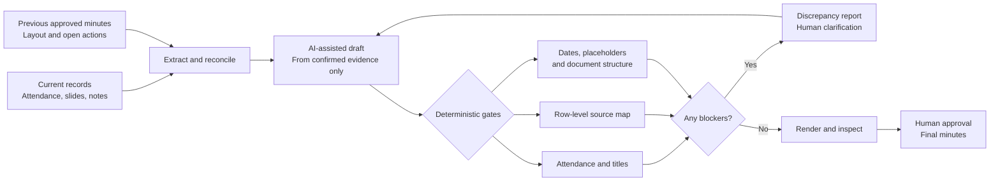

# Community Minutes Builder

A polished draft is not necessarily an accurate record. Reusing last month's
minutes saves formatting time, but it also makes it easy to carry forward
outdated figures, attendance, titles and unresolved actions.

Community Minutes Builder is a public, forkable Claude Code skill
(`ccc-minutes-builder`) that combines AI-assisted drafting with
deterministic checks and human approval. Given the previous approved
minutes, current attendance sheet, meeting deck and secretary's notes, it
helps produce:

1. a formatted Word draft;
2. a discrepancy report; and
3. a row-by-row source audit.

This is a developer-preview implementation of evidence and formatting gates.
A script `PASS` is not committee approval, and unsupported Word layouts are
blocked rather than being mistaken for clean records.

## How it runs

The skill runs inside the user's supported AI workspace. Meeting records are
provided directly within that user instance, and the draft and audit are
returned there.

It is not a separate website or document portal. The project does not operate
an additional service for uploading meeting records or downloading completed
minutes. This repository holds the skill and its supporting checks.

## From source documents to reviewable minutes



## The distinction that matters

| AI helps with | Code verifies | Humans decide |
|---|---|---|
| Extracting and summarising records | Attendance against confirmed evidence | Unclear handwriting and conflicting sources |
| Drafting restrained prose | Approved names, titles and terms | Whether an issue was actually discussed |
| Suggesting slide-to-row matches | A confirmed source citation for each substantive row | Whether the record is ready for approval |
| Identifying possible carry-forwards | Placeholders, dates, numbering and document shape | Final sign-off |

A suggested source is not a confirmed source: a match counts only once it is
recorded in the row source map. Missing evidence blocks the final; drafts
mark it `[TBC]` so it stays visible instead of being filled with a
plausible guess.

## Checks included today

- identify source roles from document contents rather than filenames;
- compare attendance names, titles, categories and counts;
- map each substantive minutes row to a confirmed source;
- flag stale dates, figures, statuses and embedded tables;
- check approved terminology and known name variants;
- detect placeholders, repeated words and structural anomalies; and
- preserve the latest approved Word structure where possible.

Example audit output:

```text
OVERALL VERDICT: FAIL

BLOCKER  Present count is 18 in the evidence but 17 in the minutes
BLOCKER  Row 4.4.1 has no confirmed source
BLOCKER  "Exmaple Name" differs from the approved roster spelling
WARN     An embedded image is unchanged from the previous minutes
```

This output is intended to make review easier. It is not a claim that every
meeting nuance can be resolved automatically.

## Inputs

- previous one or two months' approved minutes (`.docx`);
- current attendance or signature sheet (`.pdf` or scan);
- current meeting slide deck (`.pdf`);
- annexes and supporting records;
- the secretary's meeting notes; and
- optionally, a meeting transcript with the secretary's time-stamped
  markers (see [Transcripts and recordings](#transcripts-and-recordings)).

The skill can work with a partial set. It identifies which checks or sections
cannot be completed from the available evidence.

## Install

### As a Claude Code plugin

```text
/plugin marketplace add withJia-tech/community-minutes-builder
/plugin install ccc-minutes-builder@community-minutes-builder
```

On Claude Code 2.1.275 or later, one line does both:

```text
/plugin install ccc-minutes-builder --marketplace withJia-tech/community-minutes-builder
```

The plugin adds the skill and final-document hook; it does **not** install
Python packages, Poppler or an Office renderer. Install these separately
in a host where running local scripts is permitted.

### Manual skill upload (only workspaces with the required local tooling)

Zip the skill folder itself, so the archive contains a top-level
`ccc-minutes-builder/` folder with `SKILL.md` inside:

```bash
cd skills && zip -r ccc-minutes-builder.zip ccc-minutes-builder -x '*/__pycache__/*'
```

A manual upload gives you the skill but not the hook, so run the Phase 4
checks yourself before calling a document final.

## Runtime dependencies and preflight

Python 3.10+ and Poppler (`pdfinfo`, `pdftotext`, `pdftoppm`) are required.
Install the Python dependencies from a checked-out repository:

```bash
python -m pip install -r requirements.txt
python skills/ccc-minutes-builder/scripts/preflight.py
```

Pillow is required for slide image swaps. The `--render` preflight option also
requires LibreOffice `soffice` for optional document visual QA. A manual skill
ZIP contains instructions/scripts only: consumers must install the equivalent
runtime separately. Workspaces without a Python execution environment cannot
run the deterministic gates and must not claim a signature-ready pass.

The scripts assume the documented attendance and numbered-minutes tables.
If the document structure differs, the system fails closed for human review.
Synthetic test examples of evidence and source-map JSON live in
[`tests/fixtures/`](tests/fixtures/); do **not** put real roster data there.

## Quick start

Secretaries setting up in their own AI account: start with the
[volunteer guide](docs/volunteer-guide.md). It covers each setup, the shared
committee profile and the standard request text.

1. Install the plugin, or upload the skill, in a supported AI workspace.
2. Invoke it within that user instance.
3. Provide the available meeting records and say whether you want a draft,
   update, audit or clean final.

Example request:

> Prepare the July CCC minutes from these records. Reconcile attendance,
> preserve the approved Word format, check the titles and figures, and show me
> the discrepancies before producing a clean final.

### Run the checks directly

```bash
cd skills/ccc-minutes-builder

# Compare the Word attendance table with confirmed current evidence
python scripts/attendance_audit.py draft.docx \
  --evidence attendance.json

# Check placeholders, dates, terms, names, titles and document structure
python scripts/lint_minutes.py draft.docx \
  --previous previous.docx \
  --period January --month February --report-year 2026 \
  --profile committee-profile.json \
  --final

# Require every numbered row to have a confirmed source
python scripts/row_audit.py draft.docx \
  --deck slides.pdf \
  --previous previous.docx \
  --source-map row-sources.json

# Optional: cut a transcript down to the secretary's marked moments
python scripts/transcript_windows.py --transcript meeting.vtt \
  --markers markers.txt --recording-start 19:30
```

Each final check returns a non-zero exit status when a blocking condition
remains. This makes the checks usable in a repeatable workflow rather than only
as instructions to the model.

## Transcripts and recordings

A meeting bot or room recorder can produce a transcript, but a transcript
records what was said, not what was decided, and it misses whatever no
microphone heard. In a large hall the secretary still decides what matters.

So the skill uses a transcript only through the secretary's time-stamped
markers (`19:52 Agency update: hit-rate question owed an answer`).
`transcript_windows.py` prints the transcript around each marker, shows
speaker labels as unconfirmed, and lists unmarked speech as suggestions for
the drafter to decide. It fails closed on an empty or mistyped markers file,
a marker outside the recording, or a window with no usable speech. A meeting
tool's AI recap is not treated as a source.

Announce any recording and get agreement first. Keep audio, transcripts and
markers in an ignored `workspace/` folder; `.gitignore` blocks common
recording and transcript files. Rules: `skills/ccc-minutes-builder/references/transcripts.md`.

## Final-document hook: a scoped, fail-closed safeguard

The plugin's `PostToolUse` command checks `final*.docx` files in the **current
working directory only** by default, including mixed-case filenames. Set
`CCC_MINUTES_OUTPUT_DIR` to a dedicated output folder (absolute path, or
relative to the hook's working directory) when final files live elsewhere.
It does not recursively inspect the entire repository or unrelated work.

If a final file is corrupt, has an unsupported document shape, or contains
unresolved placeholders, the hook returns exit code `2` and reports the
failure. Invalid hook JSON, an invalid folder, or missing runtime packages
also fail closed. Drafts are left alone. The check runs **after** a shell
operation, so exit code `2` warns the host but does not undo or delete a file.

This is only a marker and structural safeguard. It does **not** certify
attendance, source maps, factual accuracy or committee approval. Always run
`attendance_audit.py`, `lint_minutes.py --final`, and `row_audit.py
--source-map` independently before manual signature review.

## Fork and tailor

The checks are generic. What differs between committees lives in one JSON
file, the committee profile, so a fork can adapt the skill without editing
any script.

1. Fork the repository, or copy `skills/ccc-minutes-builder/`.
2. Copy `skills/ccc-minutes-builder/examples/committee-profile.example.json`
   and replace the placeholders with your committee's approved terms:
   - `term_replacements`: wrong or old wording mapped to the approved form;
   - `people`: canonical names, allowed titles and known misspellings;
   - `action_tags`: the agency tags used in your action column (leave the key
     out to skip that check; there is no built-in list).
3. Pass it with `--profile` as shown in "Run the checks directly".
4. Run the synthetic tests, then try one sanitised real-world document. Log
   any failure in `research/failures.md` with a regression test that pins it.
5. Edit `references/house-style.md` and the wording in `SKILL.md` to match
   your committee's naming, register and section order. These are prose,
   not code, and are the parts most likely to need your own judgement.
6. Rename the plugin in `plugin.json` and `.claude-plugin/marketplace.json`
   if you publish your own copy. `tests/test_structure.py` checks the names
   still match.

Keep real minutes and attendance sheets out of your fork if it is public;
use synthetic fixtures like those in `tests/fixtures/`.

## Releases and updates

An installed plugin is a snapshot: Claude Code copies it into a cache and
loads the copy. The plugin version is set in
`plugins/ccc-minutes-builder/.claude-plugin/plugin.json`, and Claude Code
only offers an update when that string changes. Pushing commits without
bumping it reaches nobody who has already installed the plugin.

So each reviewed release bumps `version`, and unreleased commits on `main`
are not shipped. Auto-update is off by default for third-party
marketplaces, so users also run `/plugin marketplace update` to see a new
release. If you would rather every commit reach users, delete `version`
from `plugin.json` and Claude Code will use the commit instead.

**0.2.0** removes the built-in list of agency tags (`NPC`, `LTA`, `HDB`,
`NEA`, `CCKTC`, `FSC`) from the linter. If you relied on it, add
`"action_tags": [...]` to your profile.

## Model use

The workflow is designed to run on a smaller capable model first. Where the
host provides model controls, it uses low-temperature generation and starts
with a Sonnet-class model. An Opus-class model is considered only when the user
requests it or a complete first pass leaves a named material blocker that the
deterministic checks cannot resolve.

Where those controls are unavailable, the skill continues conservatively
without claiming that a particular model or temperature was selected.

## What still requires judgement

- uncertain handwriting or signatures;
- conflicting current sources;
- discussion or decisions absent from the supplied notes;
- whether an older open item remains active; and
- the final secretariat review and committee approval.

The skill flags these areas instead of filling the gap with plausible prose.

Current technical limitations are also visible:

- attendance extraction expects the established Word attendance-table pattern;
- spelling and title enforcement depends on an approved committee profile;
- keyword-based slide matches are suggestions until a source map confirms them;
- image comparison can detect unchanged embedded files, but not every stale
  table that has been re-exported; and
- scanned signatures and image-heavy slides still require visual review.

## Validation status

The original synthetic test suite is supplemented with release-gate tests
covering unconfirmed slide suggestions, unsupported table layouts, duplicate
and unnumbered rows, damaged DOCX packages, first substantive title mentions,
split Word runs, nested tables, image paths/temp cleanup and cross-year dates.
`python-docx`-generated Word-compatible documents are exercised; **actual
Microsoft Word-produced documents have not been certified** unless separately
reported. See [`RELEASE_CHECKLIST.md`](RELEASE_CHECKLIST.md) for the gates that
must pass before a release is tagged. CI tests Python 3.10–3.12 and validates
Claude Code plugin metadata. CI evidence is pending until it has run against
the exact candidate commit.

Further tests confirm that the example committee profile is valid and runs
through the linter, and that action tags are checked only when the profile
lists them. The plugin's manifests, skill paths and hook paths resolve, and no
symlink loops back into the plugin. The failures in
[`research/failures.md`](research/failures.md) stay fixed, each pinned by a
regression test. Every entry in the failures log so far comes from synthetic
stress tests, not real meetings.

## Repository structure

```text
community-minutes-builder/
├── README.md
├── LICENSE
├── requirements.txt              # lxml, Pillow runtime
├── requirements-dev.txt          # pytest, python-docx test runtime
├── CONTRIBUTING.md              # MIT contributions policy
├── THIRD_PARTY_NOTICES.md       # dependency attribution
├── RELEASE_CHECKLIST.md         # mandatory release gates
├── SECURITY.md                  # meeting-data handling
├── .claude-plugin/
│   └── marketplace.json          # lists the plugin below
├── .github/workflows/ci.yml      # py_compile + pytest on Python 3.10–3.12
├── skills/
│   └── ccc-minutes-builder/      # the skill itself
│       ├── SKILL.md
│       ├── examples/
│       │   └── committee-profile.example.json
│       ├── references/
│       │   ├── house-style.md
│       │   ├── docx-mechanics.md
│       │   └── transcripts.md      # evidence rules for transcripts
│       └── scripts/
│           ├── docx_layout.py      # shared fail-closed document shape
│           ├── preflight.py        # runtime dependency check
│           ├── attendance_audit.py
│           ├── check_final_docx.py   # the Phase 4 hook
│           ├── lint_minutes.py
│           ├── row_audit.py
│           ├── swap_slide_images.py
│           └── transcript_windows.py # marker windows from a transcript
├── plugins/
│   └── ccc-minutes-builder/
│       ├── .claude-plugin/plugin.json
│       ├── hooks/hooks.json
│       └── skills/ccc-minutes-builder -> ../../../skills/ccc-minutes-builder
├── docs/
│   └── volunteer-guide.md        # setup and standard request for secretaries
├── research/
│   └── failures.md               # observed failures, fixes and their tests
└── tests/
    ├── fixtures/                 # synthetic JSON, transcripts + build.py
    ├── test_gates.py
    ├── test_hook.py
    ├── test_release_gates.py
    ├── test_structure.py
    └── test_transcripts.py
```

The skill lives in `skills/ccc-minutes-builder/`. Paths inside `SKILL.md`,
such as `scripts/lint_minutes.py`, are relative to that folder. The plugin
reaches the skill through a symlink to that folder (never to the repository
root, which would make the plugin contain itself); Claude Code copies the
real files when it installs the plugin. For a manual upload, zip the skill
folder; its name matches the `name` field in `SKILL.md`.

## Running the tests

```bash
pip install -r requirements-dev.txt
python -m pytest tests/ -v
```

The Poppler tests require `pdfinfo` and `pdftotext`. CI installs Poppler,
so skipped slide tests are not treated as a sufficient release gate. The `.docx` and `.pdf` fixtures are generated into a
temporary folder at test time by `tests/fixtures/build.py`, so the
repository's rule against committing Word and PDF files stays intact.

## Privacy and affiliation

This is an **independent, unofficial** community project. It is not
affiliated with, endorsed by, sponsored by, or approved by any CCC,
grassroots organisation, government agency, or AI model provider.
Official minutes require authorised review and approval. The skill is not
an automated approval authority and does not replace secretariat review.
Passing tests do not prove correctness on unseen formats, scans or meeting
scenarios.

Do not commit real minutes, attendance sheets, signatures, personal data or
other meeting records to this public repository. Use an ignored
`workspace/` directory for live inputs, unpacked DOCX packages, temporary
renderings and previews. See [`SECURITY.md`](SECURITY.md). Use synthetic or fully
sanitised fixtures for testing.

Users remain responsible for applying their organisation's information-
handling requirements within the AI workspace they choose.

## Contributing and licensing

Contributions are accepted under MIT with no copyright assignment; see
[`CONTRIBUTING.md`](CONTRIBUTING.md). Dependency licences and attributions
are summarised in [`THIRD_PARTY_NOTICES.md`](THIRD_PARTY_NOTICES.md).
**Before release, confirm the actual rights holder** and complete the
`LICENSE` copyright line. The GitHub handle `withJia-tech` does not
by itself establish legal ownership. See the release checklist.


The repository is intended to improve through observed failure cases. A useful
contribution should make one behaviour clearer, more repeatable or easier to
verify. Record each failure in [`research/failures.md`](research/failures.md)
following its protocol: symptom, root cause, smallest fix, and a regression
test plus a true-positive test that pin it.

Fork the project or create a branch, test the change with synthetic or
sanitised material, run `python -m pytest tests/`, and submit it for
review. Please preserve four working principles:

- current evidence over inherited text;
- explicit uncertainty over plausible inference;
- deterministic checks before model escalation; and
- one reviewed release for operational use.

Installed skills are snapshots. Users need to add a newer reviewed release to
receive subsequent changes.

## Status

This is a developer preview pending release verification. It is intended to assist a human
secretariat, not replace review, approval or signature. The next improvements
should follow real use: record the failure, make the smallest useful control,
and test it again.
